<div align="center">
  
</div>

<div dir="rtl">

# زحل | Zohal Connect

**قندشکن زحل: وصل شو، بی‌دردسر.**

</div>

<div dir="rtl">

«فیلترشکن» را همه می‌شناسیم. این یکی را گذاشتیم «قندشکن»، چون قرار است اینترنت دوباره شیرین شود.

زحل برنامه‌ای برای ویندوز، لینوکس و اندروید است که روی هسته‌ی متن‌باز [Aether](https://github.com/CluvexStudio/Aether) ساخته‌ی CluvexStudio سوار شده. Aether از WARP کلودفلر با MASQUE و WireGuard استفاده می‌کند و کار سخت را انجام می‌دهد. ما فقط دور آن یک برنامه‌ی درست‌وحسابی پیچیدیم، همان چیزی که آدم دلش می‌خواهد روی گوشی و لپ‌تاپش داشته باشد.

## چرا ساختیم

- از اینکه هر بار وصل شدن یک دقیقه طول بکشد خسته شده بودیم.
- از برنامه‌هایی که وسط کار قطع می‌شوند و اینترنت را نصفه‌نیمه رها می‌کنند.
- از رابط‌هایی که شلوغ‌اند و فارسی را انگار از سر ناچاری گذاشته‌اند.

## چه چیزهایی دارد

**اتصال سریع.** برنامه آخرین دروازه‌های سالم هر شبکه را به خاطر می‌سپارد و چند روش را هم‌زمان امتحان می‌کند. هدف ما اتصال زیر ۲ ثانیه است وقتی قبلاً به همان شبکه وصل شده‌اید. اعداد واقعی را در `docs/GATES.md` می‌نویسیم، نه شعار.

**کل سیستم، نه فقط مرورگر.** حالت TUN همه‌ی ترافیک را از تونل رد می‌کند. اگر نخواستید، حالت پراکسی سیستم هم هست.

**ناسازگاری ندارد.** هر تغییری که روی مسیرها، DNS یا تنظیمات پراکسی می‌دهیم، اول در یک دفترچه‌ی ثبت می‌شود و بعد اجرا می‌شود. اگر برنامه وسط کار بمیرد، دفعه‌ی بعد خودش همه‌چیز را سر جایش برمی‌گرداند. به چیزی که مال ما نیست دست نمی‌زنیم.

**نشتی ندارد.** DNS و IPv6 زیر نظر هستند و سایت‌های داخلی (`.ir`) و شبکه‌ی محلی به‌صورت پیش‌فرض مستقیم باز می‌شوند. بانک‌ها و درگاه‌ها دیگر با آی‌پی خارجی گیر نمی‌دهند.

**کلیک‌های پشت‌سرهم هم مشکلی ایجاد نمی‌کنند.** موتور برنامه فقط به آخرین خواسته‌ی شما نگاه می‌کند، پس هرچقدر روی دکمه بزنید چیزی خراب نمی‌شود.

**رابط ساده و فارسی.** فقط فارسی، راست‌به‌چپ، فونت وزیرمتن، عدد فارسی، گوشه‌ی تیز و یک دکمه‌ی اصلی. رنگ‌ها را هم از تم سیستم می‌گیرد.

**حریم خصوصی.** بدون تحلیل‌گر، بدون تلمتری، بدون گزارش خودکار، بدون حساب کاربری. هیچ‌چیز جایی ارسال نمی‌شود، جز ترافیک شما به لبه‌ی کلودفلر.

## وضعیت پروژه

زحل هنوز بتاست. هرچه روی کاغذ نوشته‌ایم و تست نشده، در `docs/KNOWN_LIMITS.md` صادقانه آمده است. اگر چیزی خراب بود، لطفاً یک issue باز کنید. شرمنده نمی‌شویم، فقط درستش می‌کنیم.

## ساختار پروژه

```
zohal-connect/
  engine/                موتور اتصال (Rust)
    crates/
      zohal-proto/       پروتکل ارتباط، تنظیمات، کدهای خطا
      zohal-engine/      ناظر اصلی، نردبان خودکار، حافظه‌ی دروازه‌ها، دفترچه‌ی بازیابی
      zohal-platform/    مسیریابی لینوکس، ویندوز، حالت پراکسی
      zohal-tun/         رابط TUN و شمارنده‌ی ترافیک
      zohald/            سرویس پس‌زمینه (service، user، cleanup، status)
      zohal-bridge/      پل بین رابط و موتور
  app/                   رابط کاربری (Flutter)
  packaging/             بسته‌بندی deb، rpm و نصب‌کننده‌ی ویندوز
  docs/                  معماری، تصمیم‌ها، نتیجه‌ی آزمون‌ها و راهنمای تست دستی
```

## ساخت از روی سورس

موتور:

```bash
cd engine
cargo build --release -p zohald
cargo test --all
```

آخرین نسخه‌ی پایدار Rust را نصب کنید. Aether در نسخه‌ی ۲٫۳٫۰ به Rust 1.98 نیاز دارد.

رابط:

```bash
cd app
flutter pub get
flutter analyze
flutter test
flutter build linux --release
```

آخرین نسخه‌ی پایدار Flutter کافی است.

## مشارکت

پیشنهاد، گزارش خطا و پول‌ریکوئست خوش‌آمد است. فقط یک خواهش داریم: کدی که نفهمیده‌اید چه می‌کند، وارد پروژه نکنید.

## سپاس

زحل بدون کار خوب [CluvexStudio](https://github.com/CluvexStudio) روی Aether ممکن نبود. از Cloudflare quiche، tun2proxy، Wintun و فونت وزیرمتن هم ممنونیم. مجوز هرکدام در پوشه‌ی `THIRD_PARTY_LICENSES` است.

## مجوز

زحل تحت [AGPL-3.0](https://github.com/arsamadineh/zohal-connect/blob/main/LICENSE) منتشر می‌شود. یعنی آزاد است، آزاد بماند.

</div>

---

## English (short)

Zohal Connect is a cross-platform censorship-circumvention client for Windows, Linux and Android, built on the open-source [Aether](https://github.com/CluvexStudio/Aether) core (Cloudflare WARP over MASQUE/WireGuard). It adds a TUN and system-proxy engine, a crash-safe journal that undoes every system change, a gateway cache for fast reconnects, and a Persian-only RTL interface.

It is beta software. Known limits are listed in `docs/KNOWN_LIMITS.md`. Licensed under AGPL-3.0.
